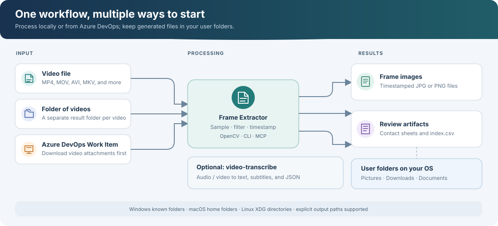
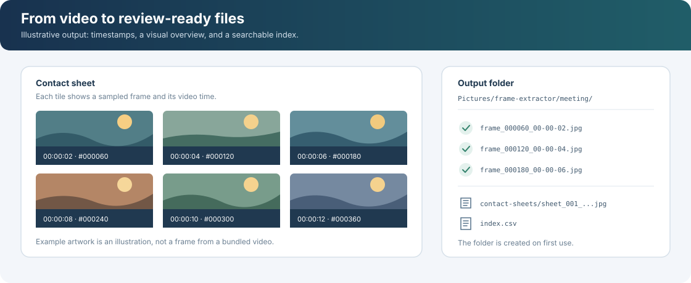

# Frame Extractor

Extract video frames, create contact sheets, and transcribe audio from the command line or an MCP client. Frame Extractor runs on Windows, macOS, and Linux, and saves output to the user's standard folders rather than inside the project.



## Features

- Extract frames from a video or a folder of MP4 files.
- Sample by time or frame count; optionally restrict extraction to a time range.
- Skip near-duplicate frames and include timestamps in file names.
- Generate contact sheets and a CSV index for easier review.
- Download video attachments from Azure DevOps Work Items.
- Expose frame extraction as an MCP tool.
- Transcribe audio with the optional `video-transcribe` command.

## Install

Requires Python 3.10 or later.

```shell
git clone https://github.com/ram-ai-wq/frame-extractor.git
cd frame-extractor
```

Create and activate a virtual environment, then install the project:

**Windows PowerShell**

```powershell
py -m venv .venv
.\.venv\Scripts\Activate.ps1
python -m pip install -e .
```

**macOS and Linux**

```shell
python3 -m venv .venv
source .venv/bin/activate
python -m pip install -e .
```

The project uses `opencv-python-headless`, which does not require desktop GUI libraries and is suitable for servers and containers. If upgrading an environment that already has `opencv-python`, uninstall it first (`python -m pip uninstall opencv-python`); both packages provide `cv2` and should not be installed together.

## Quick start

```shell
# Save one frame every 2 seconds, with timestamps and a contact sheet
frame-extractor meeting.mp4 --every-seconds 2 --timestamps --contact-sheet

# Process a folder of MP4 files
frame-extractor ./recordings --every-seconds 5

# Choose an output directory explicitly
frame-extractor meeting.mp4 --output-dir ./review --every-frames 30
```

By default, the CLI samples every three seconds and saves JPEG images. For a single video, the default output folder is named after the video. For a folder, each video gets its own subfolder.



## Where files are saved

Defaults are resolved with [`platformdirs`](https://github.com/tox-dev/platformdirs) and created when needed.

| Output | Windows | macOS | Linux |
|---|---|---|---|
| Frames | `<Pictures>/frame-extractor/<video>` | `~/Pictures/frame-extractor/<video>` | XDG Pictures directory + `/frame-extractor/<video>` |
| Azure DevOps video downloads | `<Downloads>/frame-extractor` | `~/Downloads/frame-extractor` | XDG Downloads directory + `/frame-extractor` |
| Transcripts | `<Documents>/frame-extractor/transcripts` | `~/Documents/frame-extractor/transcripts` | XDG Documents directory + `/frame-extractor/transcripts` |

Windows uses the actual known folders (including folders redirected to OneDrive). Linux honors XDG user-directory settings, including localized folder names. Pass `--output-dir` (`-o`) to choose a different frame or transcript folder; use `--downloads-dir` to change the Azure DevOps download folder.

## Frame extraction options

| Option | Description |
|---|---|
| `-o`, `--output-dir` | Output folder. Defaults to `<Pictures>/frame-extractor/<video>` for one video, or one subfolder per video in directory mode. |
| `-s`, `--every-seconds` | Save one frame every N seconds. |
| `-n`, `--every-frames` | Save one frame every N video frames. Mutually exclusive with `--every-seconds`. |
| `-f`, `--format` | `jpg` (default), `jpeg`, or `png`. |
| `-q`, `--quality` | JPEG quality from 0 to 100 (default: 95). |
| `-m`, `--max-frames` | Stop after saving this many frames. |
| `--start`, `--end` | Restrict extraction to a time range in seconds or `[hh:]mm:ss` format. |
| `--min-change` | Skip sampled frames whose visual change from the last saved frame is below the given 0-100 score. Around `2` is a useful starting point for screen recordings. |
| `--timestamps` | Include the video timestamp in frame file names. |
| `--no-index` | Do not write `index.csv` (enabled by default). |
| `--contact-sheet` | Create labeled JPEG contact sheets from the saved frames. |
| `--sheet-grid`, `--sheet-width`, `--sheet-dir` | Set contact-sheet layout, thumbnail width, or output folder. Defaults: `3x3`, `640` px, and `<output-dir>/contact-sheets`. |

The index contains the file name, frame number, video time, timestamp, and (when enabled) change score. Contact sheets display the time and frame number for each thumbnail.

## Azure DevOps (`ado-frames`)

`ado-frames` downloads video attachments from a Work Item, then extracts frames. The PAT requires the **Work Items (Read)** scope. Set credentials in your shell environment rather than saving them in scripts or configuration files.

**PowerShell**

```powershell
$env:AZURE_DEVOPS_PAT = "<your PAT>"
$env:AZURE_DEVOPS_ORG_URL = "https://dev.azure.com/YourOrganization"
ado-frames 402221 --every-seconds 2 --format jpg
```

**macOS and Linux**

```shell
export AZURE_DEVOPS_PAT="<your PAT>"
export AZURE_DEVOPS_ORG_URL="https://dev.azure.com/YourOrganization"
ado-frames 402221 --every-seconds 2 --format jpg
```

By default, only the first video attachment is processed. Use `--all` to process every video, `--skip-existing` to reuse completed downloads, `--downloads-dir` to change the download location, and `-o` to set the frames root. See `ado-frames --help` for all options.

## MCP server

The stdio server exposes the `extract_video_frames` tool. `output_dir` is optional; when omitted, frames go to the standard Pictures location.

Example client configuration:

```json
{
  "mcpServers": {
    "frame-extractor": {
      "command": "/absolute/path/to/frame-extractor/.venv/bin/python",
      "args": ["-m", "frame_extractor.mcp_server"]
    }
  }
}
```

Use the virtual environment's Python executable: `.venv/bin/python` on macOS and Linux, or `.venv\Scripts\python.exe` on Windows. Some clients, including VS Code, use a `servers` key instead of `mcpServers`. The MCP server must be able to access the video path supplied to the tool.

## Audio transcription (`video-transcribe`)

Install the optional transcription dependencies in the activated environment:

```shell
python -m pip install -e ".[transcribe]"
```

Install FFmpeg and make it available on `PATH`, or install the bundled fallback with `python -m pip install imageio-ffmpeg`.

| OS | FFmpeg installation |
|---|---|
| Windows | `winget install Gyan.FFmpeg` |
| macOS | `brew install ffmpeg` |
| Debian/Ubuntu | `sudo apt install ffmpeg` |

```shell
# Writes .txt, .srt, and .json files to <Documents>/frame-extractor/transcripts
video-transcribe meeting.mp4

# Use domain vocabulary and resume an interrupted run
video-transcribe meeting.mp4 --name meeting --prompt-file vocabulary.txt --carry-prompt --resume
```

The default model is `small`, language is Portuguese (`pt`), and processing uses CPU `int8`. Models are downloaded from Hugging Face on first use and cached locally. Use `--offline` to require a cached model, `--model` to select another model, and `--output-dir` (`-o`) to change the transcript destination. See `video-transcribe --help` for the full option list.

## Python API

The extraction core can also be used directly. Unlike the CLI, the library function requires an explicit output directory:

```python
from frame_extractor import extract_frames

result = extract_frames(
    "meeting.mp4",
    "output/meeting",
    every_seconds=2,
    timestamp_names=True,
)

print(f"Saved {result.frames_saved} frames to {result.output_dir}")
```

## Troubleshooting

- **OpenCV cannot open a video:** confirm that the file is readable and that the path is accessible to the process.
- **Non-ASCII path on Windows:** the extractor retries video access through a temporary ASCII-named alias in the output directory.
- **FFmpeg not found:** install FFmpeg and add it to `PATH`, or install `imageio-ffmpeg`.
- **MCP cannot find a video:** provide a path visible to the machine running the MCP server.
- **No frames or transcript appear in the project:** this is expected; check the command's printed output path in your user folders.

## License

This project is distributed under the MIT License. See [LICENSE](LICENSE).
